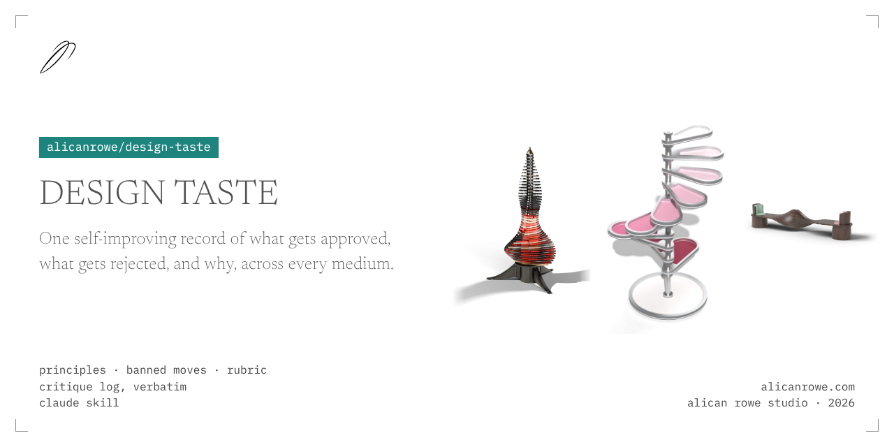

# Design taste skill

A Claude skill that holds one client's design taste across every medium they work in (cast jewelry, cast-metal
furniture, carved wood, leather boots, jackets and bags, machines, web pages and renders), built from every pick,
rejection and approval in their reviews.

It has four parts:
- **Principles** with the client's own words and a strike count for each, so the most-missed rules stand out.
- **Banned moves** that fail a design outright.
- **A scoring rubric** (five gates and twelve scored criteria, plus a part-by-part close-up sheet) that a design
  must pass before anyone sees it.
- **A critique log** that every design session appends to, so the skill improves with each review.

Domain skills (casting, furniture, boots and bags, site publishing) point here for taste and keep only their own
craft rules.

See `SKILL.md` for how to use it.
